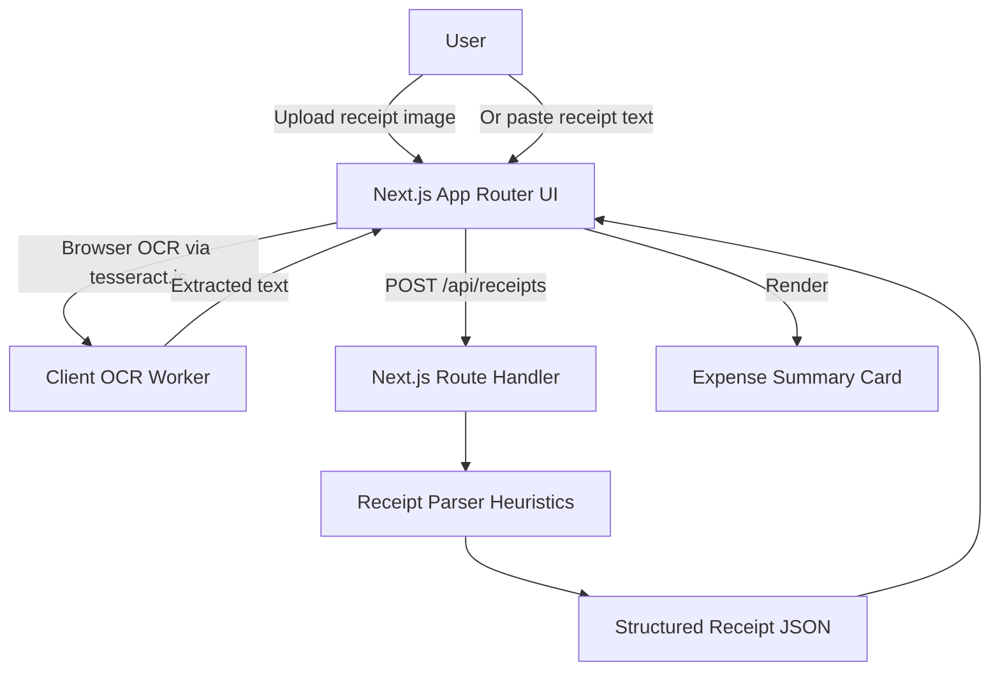

# Replay Receipt

Replay Receipt is a tiny finance-lite web app that turns an uploaded receipt image or pasted receipt text into a clean, itemized expense summary with merchant, date, total, currency, line items, and a category suggestion.

The MVP runs locally with no external API keys. Image uploads are OCR'd in the browser with `tesseract.js`, then parsed by a Next.js API route using deterministic receipt heuristics.

## Architecture



## Core feature

1. Upload a receipt image (`png`, `jpg`, `jpeg`, etc.) or paste receipt text.
2. The browser extracts text from images using OCR.
3. The server parses the text into a structured receipt object.
4. The page renders the itemized expense summary end-to-end.

## Run instructions

Requirements: Node.js 18+.

```bash
npm install
npm run dev
```

Open http://localhost:3000.

## Environment variables

Copy `.env.example` to `.env.local` if you want to customize the app.

| Variable | Required | Description |
| --- | --- | --- |
| `NEXT_PUBLIC_APP_NAME` | No | Display name used by the UI. Defaults to `Replay Receipt`. |

No paid AI/OCR service is required for this MVP.

## Notes

- OCR quality depends on receipt image clarity. For best results, use a well-lit, straight-on image.
- The parser is intentionally local and transparent. It looks for common receipt patterns such as merchant headers, dates, totals, prices, and keywords for category suggestions.
